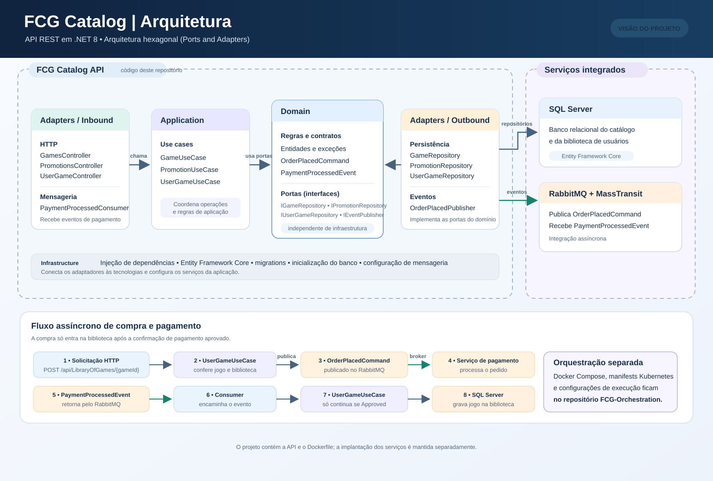
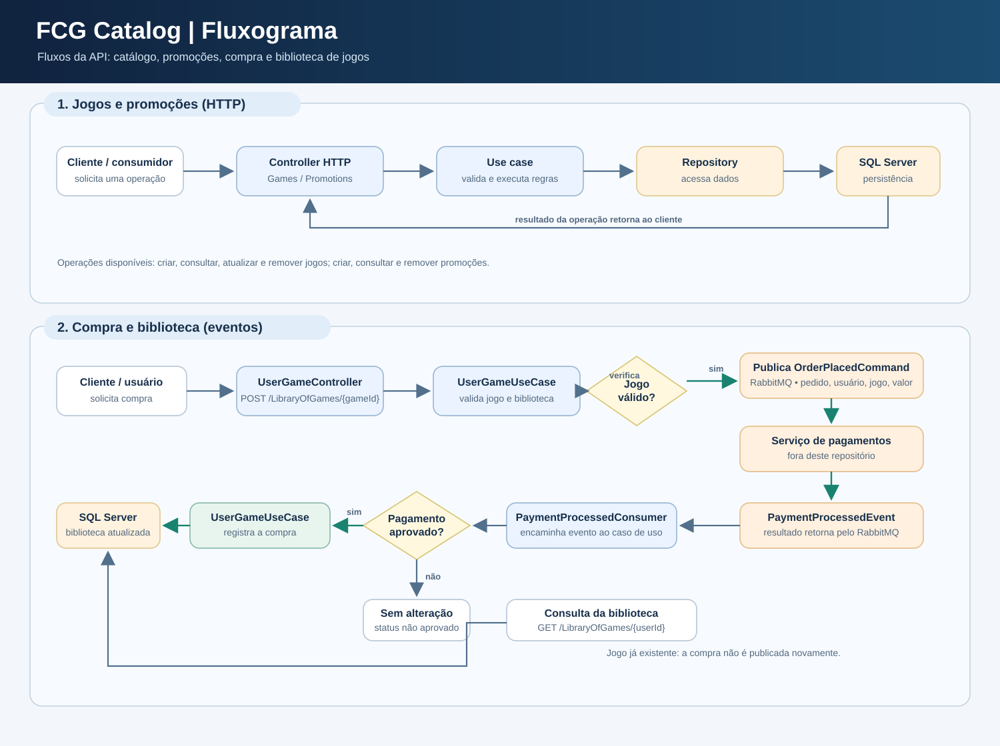

# FCG Catalog

API REST para gerenciamento do catálogo de jogos, promoções e biblioteca de
usuários. A API usa SQL Server para persistência e RabbitMQ para integrar o fluxo
de pedidos e pagamentos.

## Responsabilidades

- Gerenciar jogos e promoções.
- Receber solicitações de compra e publicar `OrderPlacedCommand` no RabbitMQ.
- Consumir `PaymentProcessedEvent` e adicionar o jogo à biblioteca somente
  quando o pagamento for aprovado.
- Consultar a biblioteca de jogos de um usuário.

O pedido publicado não adiciona imediatamente o jogo à biblioteca; essa inclusão
ocorre após a confirmação de pagamento aprovada.

## Arquitetura e organização

O projeto segue **arquitetura hexagonal (Ports and Adapters)**: os casos de uso
dependem de portas definidas pelo domínio, enquanto controllers, banco de dados
e mensageria são adaptadores substituíveis.

- `Domain`: entidades, eventos, exceções e interfaces (portas) da aplicação.
- `Application/UseCases`: regras e fluxos de jogos, promoções e biblioteca.
- `Adapters/Inbound`: endpoints HTTP e consumer de eventos de pagamento.
- `Adapters/Outbound`: repositórios SQL e publicação de pedidos.
- `Infrastructure`: configuração de dependências, Entity Framework Core,
  SQL Server, migrations e inicialização do banco.

Tecnologias principais: .NET 8 / ASP.NET Core, Entity Framework Core, SQL Server,
MassTransit e RabbitMQ.



### Fluxo das operações



## Código e implantação

Este repositório contém o código-fonte da API e seu `Dockerfile`. Os arquivos de
configuração de execução, o Docker Compose e os manifests do Kubernetes ficam no
repositório de orquestração:

[FCG-Orchestration](https://github.com/pri-pereiras/FCG-Orchestration)

Por isso, não há `docker-compose.yaml` nem manifests Kubernetes na branch `main`
deste projeto. Consulte o repositório de orquestração para configurar e iniciar
a API junto com SQL Server e RabbitMQ.

Para executar a API localmente, use o .NET SDK 8 e configure o acesso ao SQL
Server e ao RabbitMQ conforme as instruções do repositório de orquestração:

```powershell
dotnet restore FCG_Catalog.sln
dotnet run --project src/FCG_CatalogAPI/FCG_CatalogAPI.csproj
```

## Endpoints principais

Consulte o Swagger da API em execução para a documentação completa.

| Método | Rota | Função |
| --- | --- | --- |
| `GET`, `POST`, `PUT`, `DELETE` | `/Game` e `/Game/{id}` | Consultar e gerenciar jogos |
| `GET`, `POST`, `DELETE` | `/api/Promotions` e `/api/Promotions/{id}` | Consultar e gerenciar promoções |
| `POST` | `/api/LibraryOfGames/{gameId}` | Solicitar a compra de um jogo |
| `GET` | `/api/LibraryOfGames/{userId}` | Consultar a biblioteca de um usuário |

## Build e testes

```powershell
dotnet build FCG_Catalog.sln
dotnet test FCG_Catalog.sln --settings teste\FCG_CatalogAPI.Tests\coverlet.runsettings --collect:"XPlat Code Coverage"
```

Os testes ficam em `teste/FCG_CatalogAPI.Tests`. A configuração de cobertura
define o limite e os diretórios considerados em `coverlet.runsettings`.
